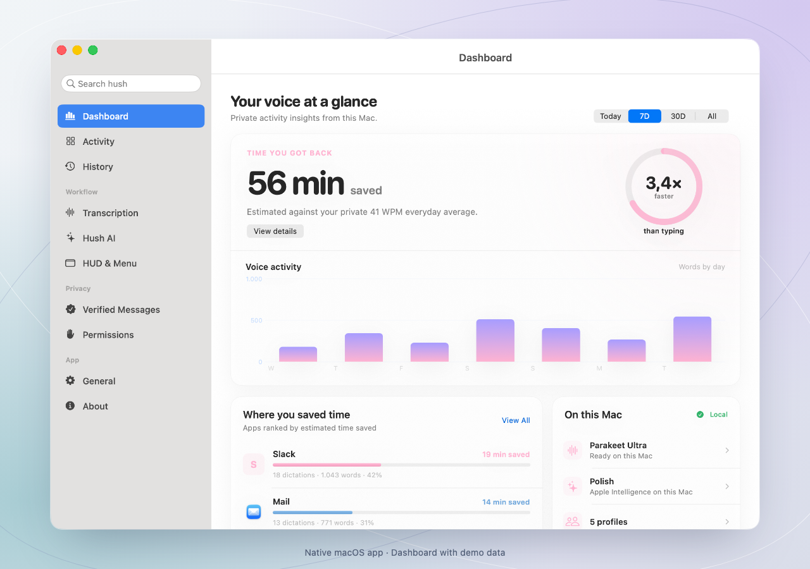
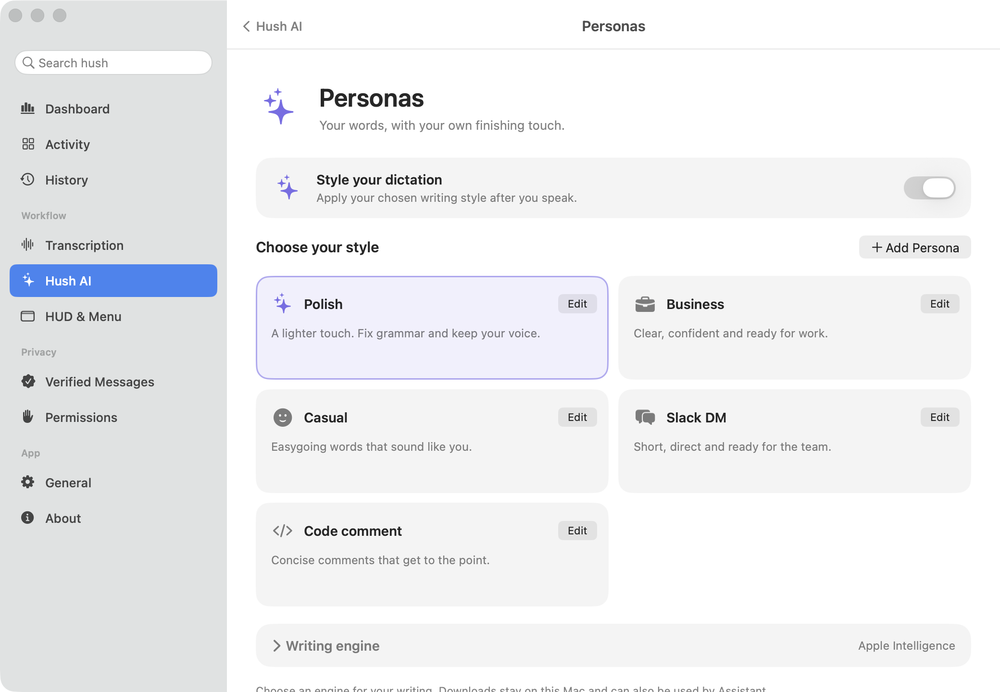

<p align="center">
  <picture>
    <source media="(prefers-color-scheme: dark)" srcset="docs/assets/hush-wordmark-dark.svg">
    
  </picture>
</p>

<h1 align="center">The voice layer for your Mac.</h1>

<p align="center">
  Dictation, writing, and a local AI assistant.<br>
  Native to your Mac. Open to your ideas.
</p>

<p align="center">
  <a href="https://behu.sh/"><strong>Download for Mac</strong></a> ·
  <a href="https://behu.sh/releases">Releases</a> ·
  <a href="docs/README.md">Documentation</a> ·
  <a href="CONTRIBUTING.md">Contribute</a>
</p>

<p align="center">Apple silicon · macOS 15+<br>Free and open source. Currently in alpha.</p>



<p align="center"><sub>Dashboard with demo data. Captured from the native macOS app.</sub></p>

Your computer should make room for your thoughts. **hush** lets you speak into the
apps you already use, shape your words with local AI, and keep your flow. Speech
recognition and AI inference run on your Mac.

## Start with your voice

1. [Download the notarized alpha](https://behu.sh/), open the DMG, and drag **hush** into **Applications**.
2. Open hush and follow the guided microphone and Accessibility setup.
3. Put your cursor in a text field. Hold **Fn**, speak, and release to insert your words.

The bundled speech model works offline. Optional models download once through
settings. Shortcuts are configurable; without Accessibility access, dictation can
be copied from the clipboard and pasted manually.

[Walk through your first dictation →](docs/tutorials/first-dictation.md)

**Requirements:** an Apple silicon Mac running macOS 15 or later. We target 8 GB
for transcription and recommend 16 GB for the assistant. Physical 8 GB validation
is still pending. Intel Macs are not supported.

## Make it your own

| | In hush |
| --- | --- |
| **Dictate** | Speak where you work. Choose Whisper or Parakeet models and the language coverage you need. |
| **Find your style** | Polish, rewrite, or create your own Personas using Apple Intelligence where available or downloaded Qwen models. |
| **Ask for a hand** | The optional **Assistant (Beta)** uses local AI to understand your active window and carry out supported actions. Hold **Control + Fn** to talk; **Escape** stops the conversation. |
| **Keep the story** | Optional **Verified Messages** let recipients inspect a signed capture and edit record through a private link. |

<details>
<summary><strong>A closer look at Personas</strong></summary>



Choose a writing style or create your own. Model setup and removal stay beside
the feature that uses them.

</details>

**This is an alpha.** The assistant is experimental, and desktop automation
depends on what each app exposes. Setup, model choices, and behaviour may change.
See the [release notes](https://behu.sh/releases) for the published build.

## Local by design

Dictation and local AI work without a cloud inference service or an account.
The assistant requests screen access separately; ordinary dictation does not
need Screen Recording permission.

Downloads and update checks use the network. If you enable Verified Messages,
hush uploads an encrypted message record. The original audio is not uploaded;
the decryption key stays in the private link, and recipients decrypt in their
browser. A signed history does not establish identity, human presence, or truth.

[Privacy](https://behu.sh/datenschutz) ·
[How Verified Messages work](macos/docs/user-journeys/verified-messages.md)

## Built for this Mac

Swift, AppKit, and SwiftUI provide the native interface. WhisperKit and FluidAudio
handle speech; MLX runs the downloaded language and vision models. The assistant
uses macOS Accessibility and ScreenCaptureKit, with Kokoro for local speech.

```sh
git clone https://github.com/Powermama/hush.git
cd hush
open macos/Hush/Hush.xcodeproj
```

Choose the **Hush** scheme and your signing team, then run with **⌘R**. The project
uses pinned Swift packages. See the [development guide](macos/docs/development.md) for
toolchain requirements, testing, local proof-service setup, and packaging.

## One project, two parts

| Directory | What lives here |
| --- | --- |
| [`macos/`](macos/README.md) | The native Swift app, local inference, desktop actions and distribution tools. |
| [`webapp/`](webapp/README.md) | The Vite website, browser verification and Bun/Hono proof service. |

To run the website and service locally:

```sh
cd webapp
bun install --frozen-lockfile
bun run dev
```

Open `http://localhost:5173`. The API runs on port 3000. Neither service is needed
for local dictation. The [migration record](docs/monorepo-migration.md) explains
the clean baseline and preservation of the earlier histories.

## Build it with us

Good bug reports, accessibility improvements, documentation, and focused pull
requests all help. Start with the [contribution guide](CONTRIBUTING.md) or
[open an issue](https://github.com/Powermama/hush/issues).

Find your area in the [journey map](docs/reference/user-journeys.md), or learn
[how the pieces fit together](docs/explanation/architecture.md). We welcome
clear explanations, thoughtful design feedback and people learning along the way.

If hush is useful to you, **star the repository** to help others discover it.

## Star history

<a href="https://www.star-history.com/?repos=Powermama%2Fhush&amp;type=date">
  <picture>
    <source media="(prefers-color-scheme: dark)" srcset="https://api.star-history.com/chart?repos=Powermama/hush&amp;type=date&amp;theme=dark">
    
  </picture>
</a>

## License and credits

hush uses **[GNU AGPLv3 only](LICENSE)** for its original code and documentation.
Use it, remix it and share improvements under the same terms, including in
covered modified hosted versions. Commercial use is allowed.

The earlier [native MIT grant](macos/LICENSE) remains valid. Model weights,
dependencies and [artwork](webapp/public/art/CREDITS.md) retain their own terms
and attribution. Read [licensing scope and contributions](LICENSING.md) for the
boundaries and release obligations.

Built with [WhisperKit](https://github.com/argmaxinc/WhisperKit),
[FluidAudio](https://github.com/FluidInference/FluidAudio),
[MLX Swift](https://github.com/ml-explore/mlx-swift),
[MLX Swift LM](https://github.com/ml-explore/mlx-swift-lm),
and [Sparkle](https://github.com/sparkle-project/Sparkle).
