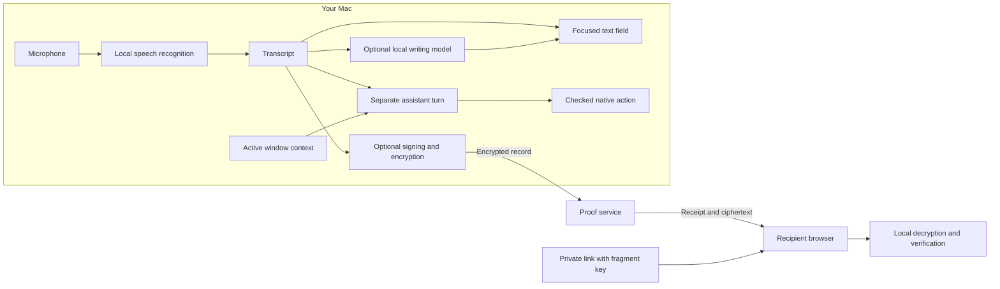

# How hush fits together

hush has two deployable parts. The Swift app handles local audio, inference and
desktop interaction. The web app provides the public website and the optional
Verified Messages service and recipient experience.

The diagram shows routes, not an automatic sequence. An assistant turn bypasses
normal dictation insertion and proof publication. A proof can also record typed
or revised text; it does not always originate from a microphone recording.

## Follow the code

| Area | Entry point | Contract |
| --- | --- | --- |
| Audio capture | [AudioRecorder.swift](../../macos/Hush/Hush/Audio/AudioRecorder.swift) | [Onboarding](../../macos/docs/user-journeys/onboarding.md) |
| Local language models | [LLMRuntime.swift](../../macos/Hush/Hush/PostProcessing/LLMRuntime.swift) | [Personas](../../macos/docs/user-journeys/persona-wheel.md) |
| Assistant and desktop actions | [Assistant/](../../macos/Hush/Hush/Assistant) | [Assistant journeys](../../macos/docs/user-journeys/hey-hush.md) |
| Native signed-message logic | [HushProvenance](../../macos/Packages/HushProvenance) | [Author journey](../../macos/docs/user-journeys/verified-messages.md) |
| API and service | [server/app.ts](../../webapp/apps/web/server/app.ts) | [OpenAPI](../../webapp/apps/web/openapi/hush-provenance.json) |
| Browser verification | [useProofVerification.ts](../../webapp/apps/web/src/provenance/useProofVerification.ts) | [Recipient journey](../../webapp/apps/web/docs/user-journeys/proof-recipient.md) |

## Data boundaries

Speech and model inference run locally. Screen access belongs to the optional
assistant, and actions are checked against the current destination. Online
desktop tasks still use their target websites or services.

When Verified Messages is enabled, hush signs and encrypts a record before
publication. Original audio is not uploaded. The link's fragment carries the
decryption key to the recipient's browser; it is not part of the HTTP request.
The service stores ciphertext and associated proof metadata, not that key.
Anyone with a complete private link has its decryption capability until the
proof becomes unavailable.

A valid signature establishes the integrity of the recorded history. It does
not establish a person's identity, biological presence or the truth of the text.
Publication or verification failures must not produce a verified success state.
See the journey contracts for the exact fields, failure states and tests.
