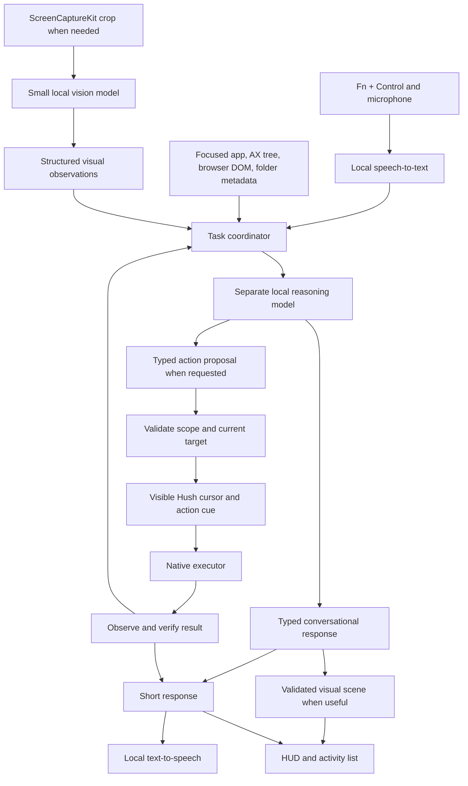

# PRD - Hey Hush: a visible, local Mac assistant

**Status:** Prototype, not release-qualified. As of 2026-11-01 the coworker implementation connects global push-to-talk, Parakeet transcription, Qwen text generation, Accessibility context, and Kokoro replies. The current source replaces the rejected response box and action buttons with a Hush cursor, short state, Escape, and direct authorized edits. Conversation and follow-ups are voice-only; there is no typed prompt. The working branch now connects source-window screenshots to native MLXVLM and adds direct searches, new tabs, exposed-control presses, and user-pointed clicks. These require validation beyond the UI fixture. Multi-step browser control, Finder organization, and calendar execution remain incomplete. See the [interaction analysis](research/2026-11-01-clicky-interaction-analysis.md), [vision audit](research/2026-11-01-mac-vision-selection.md), and [Hey Hush journey contract](user-journeys/hey-hush.md) for the target and qualification gaps.

**Date:** 2026-10-31

**Target:** MacBooks with 16 GB unified memory, M2 through M5, macOS 15+.

**Implementation evidence, 2026-11-01:** 34 focused assistant checks passed, including paired native-vision inputs and installed Parakeet/Qwen/Kokoro integration. All 11 assistant UI journeys passed again after the final hosting-view change; the optimized Release app built and was installed locally. The [validation record](research/benchmarks/2026-11-01-coworker-validation.md) separates this evidence from remaining browser, real-desktop, and M2 qualification.

**Branch:** `docs/hey-hush-local-assistant-prd`, based on `4260c24`.

**Research:** [Clicky and model comparison](research/2026-10-31-hey-hush-models.md), [small-model foundation](research/2026-10-31-small-model-foundation.md), [task-quality evaluation](research/benchmarks/quality-followup-2026-10-31.md), and [updated Mac vision selection](research/2026-11-01-mac-vision-selection.md).

## 1. Product decision

Build an optional mode inside Hush that feels like a coworker the user can speak with while working. It understands the app in front of the user, remembers the current conversation, answers briefly, and completes short, visible tasks. Invoke it with a configurable **Fn + Control** shortcut. A distinct Hush cursor appears, shows what it is targeting, and accompanies the work. The user keeps control of their own pointer and can interrupt at any time. Speaking to Hush must work before a particular action adapter is selected; Apple Mail is never an entry requirement.

The first usable product combines a complete voice loop with focused work capabilities:

1. Talk about the relevant visible conversation, document, page, or folder; answer aloud and understand follow-up instructions.
2. Write or revise text where the user is working, including a formatted email reply that uses the relevant thread.
3. Open a browser tab, search, and navigate supported pages with visible steps.
4. Prepare and arrange a meeting from the conversation using a calendar adapter, resolved participants, dates, and timezone.
5. Organize files in the current Finder folder, with a preview and undo.

Keep replies concise and useful for work. The assistant can explain with a highlight, diagram, or interactive 3D scene when requested or clearly useful. These visual explanations are an additional capability, not the default response to a work instruction. Rich graphics must not delay the basic spoken coworker experience.

The default shortcut experience is the Hush cursor, a short working-state label, and speech. Neither the large Mail form nor a smaller response box with routine Preview, Copy, Execute, or Insert buttons meets this requirement. Explicit requests to write or revise text should act in the bound editor and verify the result. Ask clarifying questions aloud and show Your turn beside the cursor. Show additional content only as read-only captions, a necessary error, or a requested diagram. Users answer and refine through voice. The listening state must not activate a Hush window or take the caret away from the source app. Keep detailed settings and model management separate from ordinary conversation.

The planner/writer target is **2-4B parameters**. A 9B model is outside the product profile, including fallback modes. Improve the surrounding system before increasing model size.

The model architecture is explicitly modular: **local speech recognition + small vision model + separate reasoning model + local speech synthesis**. These are independent components with separate lifecycles. Native tools execute actions and verify their results.

The measured prototype recommendation is **Parakeet Ultra for speech recognition, Qwen3.5-4B MLX 4-bit as the small-model integration baseline, LFM3-VL-2B 4-bit as a separate perception component, and Kokoro ANE v3 for English voice**. Supertonic 3 int4 is the measured multilingual voice challenger. Keep the model and runtime decisions separate: LFM3 ran through Python MLX-VLM here, but still needs a qualified native backend for Hush.

The November 1 vision audit retains LFM3 as the leading compact observer from the measured candidates and adds UI-Venus-1.5-2B and Holo3.1-4B as GUI-specific challengers. DeskForge-Qwen3.5-4B is a specialization experiment. None is release-qualified. The installed Qwen4B checkpoint includes vision weights and can be the native image-path integration control using MLXVLM. That transitional configuration shares one model between perception and writing; it must not be described as two independently installed models. See the [selection evidence, runtime gaps, and comparable test protocol](research/2026-11-01-mac-vision-selection.md).

The [M5/16 GiB benchmark record](research/benchmarks/README.md) and [native-tool follow-up](research/benchmarks/quality-followup-2026-10-31.md) explain this selection. Qwen4B chose correctly in 25/54 dispatcher trials and 35/54 named-tool trials over 18 development cases, with remaining context and scope failures. Its German drafts also exposed quality issues. Newer MiniCPM5, LFM3 text, and Granite pipelines did not qualify a replacement. No release planner is approved yet. The next step is a stronger foundation and held-out end-to-end evaluation, not a larger default model. Final defaults must pass section 10.

Keep Parakeet and existing WhisperKit language coverage. Do not add Moonshine. Kokoro ANE v3 has no German voice; Supertonic produced the tested German sentence quickly, but requires listening-quality qualification and an explicit decision on its archived upstream and weight terms. Pocket Small is an English streaming challenger, not a measured winner. LFM3 has revenue-conditioned open-weight terms, so this profile must not be described as uniformly permissive open source. MiniCPM-V is a permissive vision challenger; Granite 4.2 3B was tested and is not promoted; Gemma 4 E2B QAT remains an unmeasured planner alternative.

## 2. What we take from Clicky

Clicky's public repository is the earlier companion: push-to-talk, screenshot context, spoken responses, and a pointer that directs attention. Its current product also advertises an agent mode. The supplied real-time graphics demo shows contextual spoken explanations, follow-ups, generated diagrams, and 3D scenes. It does not demonstrate email or calendar execution. The private graphics and agent implementations cannot be inferred from the public companion. The [interaction analysis](research/2026-11-01-clicky-interaction-analysis.md) distinguishes these sources. [Public repository](https://github.com/farzaa/clicky), [current product](https://www.heyclicky.com/).

| Clicky experience | Hush decision |
| --- | --- |
| Invoke an assistant in the middle of work | Preserve the shortcut and immediate context |
| A buddy points to the relevant part of the screen | Make the Hush cursor a first-class action and explanation surface |
| Spoken help about what is visible, with follow-ups | Make conversation available globally; scope action execution to qualified adapters |
| Generated diagrams and 3D explanations in the newer demo | Add contextual visual explanations progressively, with measured quality limits for local models |
| Public companion uses screenshots and cloud services | Read structured app context first; perform all AI inference locally |
| Current product advertises broad agents | Ship bounded, verified tasks with explicit app support |

Build on Hush's existing native shell. Borrow the interaction principles and carefully reviewed implementation ideas from Clicky; retain attribution if code is reused. Hush already has local ASR, model downloads, MLX editing, a HUD, Accessibility context, and rich paste. Forking an additional application shell would duplicate these systems.

## 3. The experience

### HH-001 - Invoke Hush where the user is working

Hold Fn + Control to speak; release to submit directly to the assistant. It must not require a second dictation shortcut, a focused Hush text field, or a Write draft button. A quick invocation reveals the cursor with a discoverable microphone affordance. All follow-up input is spoken; do not add a typed prompt, keyboard button, or chat composer. Keep the shortcut configurable, test Globe/Fn settings and external keyboards, and do not overwrite the existing dictation shortcut.

Capture the source application and focused target before showing Hush UI. The cursor appears beside the user's pointer; the compact HUD identifies the actual context, for example `Mail - Reply` or `Finder - Downloads`. It does not claim to see a window until context acquisition succeeds. The listening indicator appears within 100 ms independently of model loading.

Use the installed Parakeet model through Hush's existing recorder and FluidAudio engine. Assistant speech is an instruction, not dictation to be pasted into the app, saved as dictated content, or published as a Verified Message. Route it using a conversation/turn identity rather than a Hush panel's key-window status. If a permission or model is missing, explain that specific limitation in the compact surface and provide its settings action. Do not redirect unrelated requests to Mail.

Maintain bounded conversational context: the current goal, user-provided constraints, relevant observed facts, selected artifacts, and verified action results. A follow-up such as "make it warmer" refers to the current draft; "actually, 11" updates the proposed meeting. Re-observe changed app state before acting. Holding the talk shortcut during a spoken reply interrupts playback and starts the next turn. Escape stops speech and pending actions. No wake-word detector or continuous recording is implied by the name Hey Hush.

### HH-002 - A cursor that makes the work understandable

The Hush cursor is a separate, recognizable overlay. It never replaces or hides the system pointer. The companion follows the user’s pointer, holding still when the user reaches its controls. Its separate target highlight identifies the actual Accessibility or browser element. Clear background space must not intercept ordinary clicks. It stays within the appropriate display and avoids covering the text being edited.

Make the acting cursor visibly identifiable as Hush, with an accessible label and a shape/name that does not rely on color alone. Show the target before a click or edit, and a brief action label such as `Writing reply`, `Opening tab`, or `Checking calendar`. Animate travel only when it represents a real target transition. A context-aware answer without an action can remain beside the user's pointer. A file or calendar API operation gets a truthful target/status cue, not invented mouse activity. The user's pointer remains independently usable throughout.

The visible sequence is:

```text
Fn + Control      Hush appears beside your pointer: "Listening"
Release           Context chip: "Mail - Reply"
Draft             "Writing a concise reply"
Before insertion  Hush points to the compose body: "Inserting your draft"
Verified result   "Draft inserted" with Undo where supported
```

Use similarly concrete states for browser steps: `Opening Downloads`, `Selecting the PDF filter`, `Checking the result`. For a file operation performed through filesystem APIs, show the folder and real move list. Never animate fictitious clicks to imply that an API operation used the mouse.

All action cues and result messages come from the executor's structured state. Do not display private model reasoning, invented progress, or an unverified success message. A compact expandable activity list records completed, skipped, failed, and cancelled steps for the current session. Keep progress and errors available even when speech is muted.

Escape cancels inference, speech, and queued actions immediately. A second Escape dismisses an already-stopped cursor. The native Esc control must work on the first click with another app active. Completed work fades after three seconds, stopped work after 1.8 seconds, and a waiting question cue after eight seconds while retaining conversation context. During actual playback, a small read-only bubble follows the cursor and shows the current utterance. An operation already committed remains visible and undoable where supported. Direct user interaction with the target pauses execution; changing application, window, tab, or editor invalidates its context. Require fresh targeting before resuming. Pointer movement during an imminent pointer-dependent action also pauses it. Merely moving the pointer elsewhere need not interrupt a safe background file move.

Support Light and Dark appearances, Reduce Motion, VoiceOver, enlarged text, Retina scaling, and multiple displays. No flashing trails or compulsory sound. The cursor must feel like a collaborator that shows its work.

### HH-003 - Write into an email

Example: in an open Apple Mail reply, say, "Thank them, say Friday works, and ask them to send the agenda. Keep it friendly."

Use explicitly selected or relevant visible thread text when needed. Generate a structured draft with paragraphs, lists, emphasis, and links supported by the destination. A deterministic renderer creates HTML, RTF, and plain text. Insert into the bound compose body, preserving the signature and quoted thread. Verify the destination and resulting content. If the target changed or cannot be verified, explain that aloud, retain the draft in session memory, and ask the user to refocus the intended editor. Never append a second draft or repeat an uncertain paste.

An explicit request to write into the current draft permits automatic insertion after the visible target cue. Suggestions and questions do not modify the draft. A subject is a separate field and is changed only when requested. Sending is outside the first release. A generic text editor receives body text only, not an invented mail workflow.

Launch formatting support is Apple Mail and Gmail in Chrome. Outlook and other editors require their own tested adapter. "Perfectly formatted" means a defined, tested formatting contract for these destinations, not a promise about every application. Unsupported styles degrade visibly to a clean plain-text version.

### HH-004 - Organize this Finder folder

Example: with Downloads open, say, "Organize this folder by file type."

Resolve the front Finder window or selected files through a fixed native adapter. If there is no unambiguous filesystem folder, ask the user to choose one. Do not infer paths from a title such as `Recents`, a screenshot, or an assumed `~/Downloads` directory.

Create a concrete move preview: file counts, source folder, categories, collisions, and skipped files. One approval authorizes that plan. Enumerate and move files with native filesystem operations; the LLM does not invent shell commands or paths. Type/date organization is deterministic. Semantic grouping can use bounded filenames and metadata, leaving uncertain files ungrouped.

Stay within the chosen folder. Do not overwrite, delete, follow symlinks outside scope, unpack archives, or move incomplete downloads. Initially skip packages, symlinks, cloud placeholders, and cross-volume destinations. Revalidate file identity and destination before every move. Journal each completed operation so Undo and crash recovery can restore paths without overwriting subsequent user changes. Report partial completion truthfully.

### HH-005 - Work in the active browser tab

Example: "Open the downloads page, choose the Mac version, and stop before downloading."

The first supported browser is Chrome, through a small extension and native messaging bridge. Use page elements and labels to navigate, scroll, select controls, and fill fields. Bind each action to tab, document revision, element, and allowed operation. After each step, observe the changed page before selecting the next step. Start with a maximum of eight actions and a 60-second deadline; stop with a useful partial result when the budget is exhausted.

Prefer a user-invoked `activeTab` grant. An app-global hotkey does not itself grant extension access. If the tab is not authorized, show a single Connect this tab action. Cross-origin navigation may require another grant; do not silently expand host permissions. Restricted pages and unsupported cross-origin frames remain unsupported. Safari is a later adapter, not implied compatibility. [Chrome activeTab](https://developer.chrome.com/docs/extensions/develop/concepts/activeTab), [native messaging](https://developer.chrome.com/docs/extensions/develop/concepts/native-messaging).

Low-impact navigation proceeds with visible cues. Do not expose send, purchase, delete, account-change, or arbitrary JavaScript execution as model tools in the first release. Explicit download workflows can be added with a separate reviewable destination step. Treat page text, email text, filenames, OCR, and visual observations as untrusted task data, never as authority to change the requested task.

### HH-006 - Explain something visible

The user can ask "What is this?", "Why did you stop?", or "Show me how this works" from any app, including outside an action workflow. Hush highlights the relevant element and gives a short spoken explanation. If structured context cannot answer the question, capture the relevant window or crop and use the small VLM. Unknown or unreadable information remains unknown. Screen understanding does not automatically authorize clicking.

Add visuals progressively: grounded highlights and arrows, labeled 2D diagrams, then interactive 3D explanations after separate qualification. A diagram is a contextual response that can be dismissed or expanded, not a compulsory chat window. Follow-ups can revise the same scene while retaining the original screen context. Use a validated scene description and a bounded renderer with labels, nodes, edges, shapes, and qualified 3D primitives/assets. Content can be generated for the current question even when rendering components are reusable. Do not claim arbitrary generated 3D geometry or parity with Clicky's private engine from a templated prototype. Do not execute unrestricted model-generated code. A factual error in a polished diagram remains a failed answer.

### HH-007 - Reply and arrange a meeting

Example: while viewing an email conversation, say, "Reply to Tom and schedule a meeting for tomorrow morning at 10."

Read the relevant thread, distinguish its author and recipients, and resolve Tom from available context. Resolve tomorrow and 10:00 using the current local date and the intended calendar timezone; show the concrete date and zone. Use an existing user preference or clear thread evidence for duration, calendar, attendees, and location. Ask one concise question when a required detail is still missing. Do not invent an address, silently assume a meeting length, or claim availability without checking the calendar.

Prepare the reply and event through separate native adapters. The user can refine them conversationally, for example "make the reply shorter" or "actually, at 11." Creating a personal event, inviting attendees, and sending the email are distinct effects. Bind each to the user's instruction and show the concrete recipient/time before an external commitment; clarify when that commitment was not specified. A request to draft alone must never send a message or invitation. Existing launch restrictions on sending email remain in effect until the sending adapter has its own qualification.

Report each result independently: a drafted reply is not a sent reply, and a suggested time is not a scheduled meeting. Verify the event identifier, date, time, timezone, and attendees after creation. Handle conflicts, denied calendar access, ambiguous contacts, partial completion, cancellation, and duplicate requests. If calendar integration is unavailable, preserve the prepared details and say the meeting has not been scheduled. Do not imply completion through speech or animation.

## 4. Intelligence settings

Use one understandable settings surface with the separate responsibilities visible. Offer a curated Balanced profile first. The following is a strategy mockup, not an implementation or measured memory report:

```text
┌──────────────────────────────────────────────┐
│ Intelligence                                 │
│                                              │
│ ● Balanced (prototype)                       │
│   Reasoning: Qwen3.5-4B · 4-bit              │
│   About 3.06 GB model files · On device      │
│                                              │
│ Screen understanding                         │
│   LFM3-VL-2B · 4-bit                         │
│   About 1.61 GB model files                  │
│   Used when the current task needs vision    │
│                                              │
│ Transcription                                │
│   Parakeet Ultra · Multilingual              │
│   About 603 MB download · Core ML            │
│   Existing Hush transcription engine         │
│                                              │
│ Voice                                        │
│   Kokoro 82M · Apple Silicon optimized       │
│   English · On device · Preview voice        │
│   Spoken replies: On / Off                   │
│                                              │
│ Local AI                                     │
│   Voice and screen analysis run on this Mac. │
│   View downloads and connection details      │
└──────────────────────────────────────────────┘
```

Approximate model sizes above come from the artifacts measured in this research, not peak RAM. The vision estimate includes the visual components. This mockup describes the proposed profile after native runtime qualification; it does not imply that LFM3 is already available in the app. The shipping UI must read exact bytes from pinned artifact manifests and distinguish **download size**, **on-disk size**, and **measured active memory**. Parameter counts are never labeled MB. Display ready, downloading, preparing, unavailable, and error states independently for each component. First-run speech-model compilation belongs in Preparing, before a time-sensitive command.

Balanced keeps task quality first. For multilingual voice, evaluate Supertonic 3 int4 as a separately downloadable choice with its actual installed size, language availability, preparation state, and voice preview. A later Compact profile can test the existing Parakeet Redux and Pocket 6.9M; smaller planner or visual weights require the same acceptance gates. Do not silently change quality according to chip generation. Do not offer arbitrary models in the first release: a compatible tensor format does not establish correct prompting, tool calling, image processing, licensing, or cancellation.

Do not use an unconditional `Nothing leaves this Mac` claim. Inference is local, but initial model downloads and app updates use the network, browser navigation contacts websites, and a mail application's drafts may sync with its provider. Hey Hush must not send audio, screenshots, or context to AI services or analytics. Its local task route does not invoke Verified Messages publication. Existing opt-in proof publication is a separately disclosed feature, not an implicit part of this mode.

## 5. Modular architecture



The vision model is a perception component: it returns relevant labels, text, locations, and uncertainty with snapshot IDs. It has no action tools. Keep OCR text and element evidence alongside its summary so a mistaken visual summary cannot become the sole record of the screen.

The reasoning model receives the user request, bounded observations, and only tools appropriate to the active capability. It proposes a typed action such as `insert_draft`, `plan_file_moves`, `press_element`, or `fill_field`. Native code validates schema, scope, freshness, arguments, and preconditions. Tool-call parsing alone is insufficient. Reject unknown, duplicate, truncated, or invalid calls before mutation.

An ordinary conversation turn can answer or ask a short question without proposing an action. Keep the conversation coordinator independent of Mail, Finder, browser, and calendar executors. The coordinator owns turn history, interruption, voice output, and visual responses; each executor owns target bindings, authority, mutation, and verification. A task-specific adapter must not become the product's entry gate again.

Use Accessibility/DOM element IDs where available. Screenshot-grounded pixel control is required for custom interfaces such as Premiere Pro, as a separately qualified fallback. Each action requires a fresh bounded capture, verified target region, coordinate conversion across display scales, a visible cursor cue, cancellation before dispatch, and post-action observation. Do not enable guessed coordinates from a text-only model. This execution path is not implemented yet.

Reuse Hush's existing controller, context capture, generation protocol, native controls, speech interfaces, and model storage. Add one bounded action loop and structured progress/results. Split code when it has a concrete independent responsibility; separate services, registries, schedulers, or plugins are not prerequisites. Keep inference off the main actor's execution path and serialize state transitions.

### 5.1. Foundation that improves small-model task quality

Apply the [researched foundation strategy](research/2026-10-31-small-model-foundation.md). First qualify tokenizer/template, conversion, stopping, native tool grammar, and sampling semantics against a reference. The benchmark's prompt-sensitive MLX presence penalty is an explicit configuration issue to compare before making a checkpoint-level quality verdict:

1. **Bind context before inference.** Resolve a real compose body, folder, or browser document. A stale, secure, missing, or ambiguous destination cannot become a mutation target merely because the model names it.
2. **Shrink the decision.** Route to one supported capability and expose only its current legal operations. If a destination is already known, native code binds it and the model supplies content only. Generate dynamic target enums where a choice is necessary.
3. **Constrain outputs.** Qualify a native XGrammar/MLX Swift integration behind `ConstrainedGenerator`. Keep checkpoint-specific templates and tool formats. Grammar constraints prevent invalid forms; independent semantic checks still govern execution.
4. **Continue a request step by step.** One action loop owns progress and cancellation. Hush's native controls execute supported actions and check their results. The model chooses the next action from current evidence.
5. **Verify and recover.** `OutcomeVerifier` reads actual state after each action. Allow one recovery with concrete evidence; never blindly repeat a potentially committed mutation. The cursor displays executor state and verified results.
6. **Protect writing facts.** Use a source-linked draft brief and structured content blocks. Native rendering handles formatting; checks preserve explicit amounts, dates, names, and conditions. Grammar and semantic quality still require held-out human review. Try a few curated examples before task/language adapters.

These responsibilities belong in the existing model, context, and native execution boundaries. One 2-4B model can perform routing and writing sequentially. Keep the implementation KISS: no skill library, recipe store, external desktop automation dependency, or multi-agent framework.

Measure matched ablations at fixed weights: native baseline, scoped context/tools, constrained generation, workflow validation, outcome verification, and curated examples or adapters. Report task completion, correct abstention, false refusal, blocked bad proposals, latency, and memory separately. Blocking every request does not satisfy the completion gates. No foundation quality gain beyond the recorded interface diagnostic is claimed yet.

### 5.2. A simple native action loop

The [OpenClaw and native Mac orchestration review](research/2026-11-01-desktop-orchestration.md) defines the next implementation contract. The current controller ends after one action. Keep one task session across repeated observation, one typed next action, native execution, result verification, and replanning. Preserve the goal and spoken corrections; refresh actionable targets after each UI change. Completion must follow observed postconditions, not model narration.

Product decision: Hush owns its open-source automation implementation using Apple APIs. OpenClaw and Peekaboo are behavioral references only. Do not add their automation packages or a skill library. Extend the existing Accessibility and ScreenCaptureKit paths; qualify Safari's native controls directly.

Require structured dispatch and verification results, one active action, bounded recovery, no replay of uncertain edits, and cancellation that blocks subsequent dispatch immediately. Reuse generic operations such as press, fill, navigate, and read across tasks. After each action, refresh the relevant screen context and validate the checkpoint before proceeding. Capture still images on demand when needed; continuous video is not required. Cursor and voice consume execution events; ordinary authorized steps need no preview or execute button. Developer recording remains compiled out of Release.

First acceptance journey: create one Safari tab, navigate to YouTube, search David Guetta, and open the first observed music-video result. Verify each checkpoint, retain scope across navigation, and distinguish opening the video page from verified playback. A request for the "most viral" video requires a clear metric and comparison scope, such as highest visible view count among inspected results; ask by voice if needed and never claim a global ranking from a partial page. Compare improvements at fixed Qwen4B weights. The research note supplies failure cases and the comparison protocol; design requirements are not test results.

### Visible progress and perceived latency

Prefer the fastest path that meets the accuracy gate: native exact commands, bounded AX context, and a new screenshot when visual evidence is needed. Never trade destination checks for a faster-looking completion. Emit real preparation, observation, decision, dispatch, and verification stages into the existing cursor capsule. Show current-stage elapsed seconds after two seconds and the current step number after the first verified action. Do not fabricate percentages or ETAs, expose hidden reasoning, or narrate unverified success. Escape stays available during every stage; cancellation stops subsequent dispatch. Measure stage latency separately from full goal completion, including cold model preparation.

### 5.3. Model independence without a plugin system

`CoworkerGenerating` is the boundary between inference and Mac behavior. Each model adapter accepts the same request, bounded conversation, current observation, and verified progress, and returns the same validated action structure. Model-specific templates, tokenization, quantization, image processing, and runtime configuration stay behind that boundary. Models never receive native handles or decide whether an action actually succeeded.

Keep the current compact local stack as the baseline. Future models must declare supported input types and context limits, run through a qualified native Apple backend, and pass the same held-out workflow suite. Compare exact model revision, quantization, runtime, prompt/schema version, accuracy, false completion, latency, and peak unified memory. A smaller download or a newer release is insufficient evidence for promotion. Upgrade one component at a time with a known working fallback; never silently use cloud inference. Standardization means a stable request/action/result contract, not adding a framework for hypothetical future models.

## 6. Integration with the existing app

| Existing implementation | Reuse and required extension |
| --- | --- |
| `AudioRecorder`, `Transcriber`, `FluidAudioTranscriber`, `WhisperKitTranscriber` | Reuse microphone ownership, existing Parakeet ASR, and language fallback |
| `LLMRuntime` | Reuse model storage and MLX lifecycle; add a validated planner interface with model-specific templates and parsers |
| `create_artifact` validation | Reuse validation principles; action schemas have separate authorization and postconditions |
| `SelectionCapture`, destination inspector | Reuse app identity and secure-field detection; bind exact window/editor identity as well as process |
| `TextInserter` | Reuse HTML/RTF/plain text; add destination verification, clipboard race protection, and supported-editor formatting tests |
| HUD and hotkey controllers | Add assistant-specific session state and a nonactivating cursor overlay |
| `AIModelStorage`, model preparation | Add component manifests, revisions, checksums, licenses, processor versions, and eviction policy |

The current insertion path reports a dispatched Command-V, not proof that an editor accepted the content. Its clipboard restore uses a fixed delay. Before adopting this path for assistant drafts, reproduce focus and clipboard races end to end, then verify insertion and restore only if Hush still owns the clipboard. Preserve all pasteboard items and types. Existing journey invariants remain authoritative: [Verified Messages](user-journeys/verified-messages.md).

Hush pins `mlx-swift-lm` 3.31.4 and FluidAudio 0.18.0 at the inspected revision. Qwen's text path is already present, but that does not establish agent-tool reliability. LFM3 and MiniCPM-V 4.7 are absent from the pinned native registries. For LFM3 perception, qualify a supported MLX Swift loader or embed llama.cpp/Metal b11960 or newer with the matching GGUF/projector. Keep either backend behind `VisionObserver`. A different runtime/export requires fresh measurements; the Python MLX timings are not shipping Swift benchmarks. No Python or HTTP daemon belongs in the production app.

Select `KokoroAneManager(version: .v3)` explicitly. Its CPU/ANE, GPU, and Accelerate routing is hybrid, not ANE-only. Native M5 tests measured about 65 ms for short English confirmations; longer inputs and first-use paths were slower. Supertonic uses `.aneBucketed(.int4)` and was faster on the tested longer inputs, with a German voice available. Both require preparation and listening-quality gates. First synthesis took seconds, so warm representative short and long shapes during setup. Pocket Small remains an unmeasured streaming alternative with FP32 CPU decoder as its quality baseline. Evaluate Core AI separately on supported OS versions; retain the macOS 15 baseline.

Finder Apple Events require the appropriate usage description, hardened-runtime entitlement, and user Automation grant. Use fixed operations with typed parameters. Folder access must handle macOS permission denials. Request Screen Recording only when a task needs visual context; structured email and file tasks should work without it. Missing permissions produce a specific explanation and a useful fallback, not repeated prompt loops.

## 7. Memory, scheduling, and compression

Target the 16 GB M2 first. CPU, GPU, and Neural Engine share unified memory. Moving ASR to Core ML can reduce GPU execution contention but does not provide a separate pool of free RAM.

Keep downloaded components independently installed. Keep the selected reasoning model warm while the assistant is active when memory permits. Load vision only for a task that requires it; release visual activations and stale caches after use. Do not run vision and reasoning generation concurrently by default. Coordinate TTS with inference to avoid competing GPU work. On memory pressure, unload optional components and offer text/structured-context operation rather than silently using a cloud provider.

Use one planner, one ASR engine, and one voice at a time. The measured Qwen planner and LFM3 vision artifacts total approximately 4.67 GB before speech, caches, and runtime allocations. This is a storage subtotal, not an active-memory claim. If residency of both models causes pressure, retain the structured visual observation and evict vision before planning. Loading penalties must appear in cold-path measurements.

Start with groupwise 4-bit weights, a maximum 4K-token text context, bounded observations, and bounded output. Limit screen inputs to the relevant window/crop with an explicit image-token budget, starting at 512 and evaluating up to 1,024 for dense UI. Do not downscale until small labels become unreadable. Preserve a high-resolution crop for ambiguous text.

Evaluate a 256-token planning output budget with up to 256 additional reasoning tokens when supported; drafts may use up to 768 output tokens. Treat these as initial tuning parameters. Never execute partial model output. Reuse prompt and image features only while their source snapshot is unchanged.

Weight quantization, context-cache quantization, distillation, and Core ML palettization are separate experiments. Prefer the smallest configuration that passes the task-quality gates. Do not enable aggressive 2/3-bit weights, TurboQuant, or speculative decoding solely because they reduce a benchmark number. See the research report for compatibility and whole-process memory considerations.

## 8. Initial performance targets

These are release targets to measure, not results obtained in this research. Measure warm and cold separately on a 16 GB M2 Air with a fixed ten-tab browser workload plus Mail and Finder open, on battery and AC.

| Metric | Initial target |
| --- | --- |
| Shortcut to visible listening feedback | p95 <= 100 ms |
| Release to recognized short command, warm ASR | p95 <= 1 second for utterances up to 10 seconds |
| Release to first actionable result without vision | p95 <= 4 seconds |
| Additional vision observation latency | p95 <= 3 seconds for the standard crop |
| Completed 150-word draft | p95 <= 12 seconds from release |
| Ready sentence to first audible TTS sample | p95 <= 700 ms |
| Escape to no further queued action / stopped speech | <= 150 ms, excluding an already committed OS operation |
| Assistant process and helper peak physical footprint | <= 7 GiB on standard scenarios, with system pressure remaining green |
| Preferred active footprint | <= 6 GiB; 7 GiB is the release ceiling, not a reservation from macOS |
| Model download budget for recommended English profile | <= 6 GB target including voice frontend assets; optional language packs counted separately |
| Idle behavior after eviction | No screen capture or heavy inference; no more than 100 MB above existing Hush baseline |

Measure process physical footprint, MLX allocations, Core ML allocations where observable, system memory pressure, swap delta, and cold compilation/loading. Do not add overlapping GPU/unified allocations twice. Investigate any sustained swap increase attributable to Hush. Repeat representative sessions for 20 minutes on a fanless Air to expose thermal degradation.

## 9. Delivery sequence

| Phase | Deliverable | Exit condition |
| --- | --- | --- |
| 0 | Retain native validators and bindings; introduce an independent conversation coordinator | Invocation fixtures cover Mail, browser, Finder, and an unsupported app without a Mail gate |
| 1 | Complete voice loop: Fn + Control, existing Parakeet, bounded app context, small-model response, local TTS, cursor, follow-ups, interruption | Real microphone-to-spoken-answer journey passes while the original app keeps focus; no unintended dictation paste; honest context/model failure states |
| 2 | Work flows: contextual email/text edits, browser search/navigation, meeting preparation and calendar execution | Real app journeys pass with correct targeting, formatting, resolved dates, verified outcomes, and authorized external commitments |
| 3 | Finder folder adapter, move preview, journal, undo | Collision, partial failure, crash recovery, and undo tests pass without data loss |
| 4 | Separate vision observation and qualified custom-control actions, generated 2D explanations, then qualified interactive 3D scenes | Grounding, factual correctness, scene validation, voice synchronization, and measured M2 resource/latency gates pass |
| 5 | Optional local wake phrase and additional app adapters | Battery/false-trigger measurements and separate capability qualification |

The architecture includes all four model roles from the outset; phased delivery does not replace it with a single multimodal model. Structured context can support the first qualified apps while the separate vision backend is qualified, but Hush must disclose unreadable visual content. Spoken replies are a phase 1 requirement, not a later adapter. A wake phrase is an additional feature. The first version is explicitly invoked and does not continuously record or inspect the screen. A custom wake detector needs suitable training data and separately checked model terms.

## 10. Evaluation and acceptance

Use fixed, synthetic or explicitly consented data. Separate development and held-out sets. Compare configurations on identical tasks and prompts, then rerun the best candidates in the actual app. Model-card scores do not establish end-to-end task completion.

| Set | Minimum coverage | Acceptance gate |
| --- | --- | --- |
| Conversation | 30 multi-turn work sessions across Mail, browser, Finder, and text editors; revisions, interruption, missing context, and app changes | One hold/release reaches a spoken local answer without taking app focus or pasting the instruction; preserve explicit constraints and resolve follow-ups; report unsupported context honestly |
| Email | 60 requests split between Mail and Gmail; varied lengths, lists, links, signatures, English/German plus intended launch languages | >= 95% supported-task completion; no wrong-field insertion or unintended send; 100% formatting assertions for the supported format subset |
| Calendar | 30 thread-to-meeting cases including ambiguous contacts, timezone/date boundaries, conflicts, missing duration, duplicate requests, and partial failures | Exact participants/date/time/timezone for every committed event; no duplicate event or unrequested invitation; truthful separate draft/event outcomes |
| Finder | 30 folder fixtures with collisions, Unicode, permissions, concurrent changes, and interrupted batches | 100% file preservation and truthful journaling; exact undo when no external edits conflict; >= 95% intended organization |
| Browser | 50 workflows of 1-8 actions, duplicate labels, delayed pages, frames, and navigation | >= 90% supported-workflow completion; zero unrequested external commits |
| Vision | 100 screen/crop questions, including icons and small text; Retina, Light/Dark, two displays | >= 95% correct relevant-element/text extraction on supported cases; report abstentions separately; no autonomous action from unsupported visual guesses |
| Voice | 60 utterances per proposed language; short confirmations, names, dates, filenames, numbers, and punctuation | No material meaning-changing reading errors; meet first-audio target; blinded listener preference before replacing reference voice |
| Visual explanations | 30 grounded 2D scenes and follow-up edits before 3D qualification; separate corpus for each supported 3D scene family | Correct factual content and labels, validated bounded scenes, readable Light/Dark layouts, dismissal and interaction checks; measure combined inference/rendering performance on M2/16 GB |
| Interruption and context | App/tab switches, user typing, moving windows, permission revocation, Escape, sleep/wake | No stale-target action; no further queued mutation after cancellation |
| Locality | Network blocked after downloads; outbound request inspection during all journeys | AI and file/draft capabilities work offline; no inference payload or analytics egress |

For browser offline testing, use local fixtures; live sites inherently require their normal network traffic. Test prompt injection through page text, filenames, and vision observations against actual action authority. Report sample counts, task exclusions, p50/p95, peak memory, repeated-run variability, and all failures. No claim of universal reliability follows from a finite passing corpus.

Map HH-001 through HH-007 into a dedicated user-journey document and XCTest UI tests when implementing. Keep Swift Testing for planner validation, file operations, rendering, and model lifecycle. For bugs, reproduce the affected end-user journey first. Inspect screenshots in both appearances and fix visible layout failures. Preserve the existing package tests, Swift-to-Hono integration, and Release-build checks required by `AGENTS.md` for implementation changes.

## 11. Explicit limits and remaining decisions

The first release has no arbitrary shell, arbitrary page JavaScript, ungrounded pixel clicking, automatic email sending, background surveillance, broad agent marketplace, or cloud fallback. A local model cannot make unsupported controls reliable by guessing.

Open empirical decisions are release-quality 2-4B planner selection after scoped-tool and workflow evaluation, LFM3 native runtime parity and dense-screen accuracy, permissive-model alternatives, voice quality per language, warm retention, and measured full-stack memory. Check 4-bit degradation against higher precision on the same held-out tasks. The default is chosen by task completion first, then latency, energy, and memory among configurations that meet the quality and trust gates. Token-throughput benchmarks alone cannot select the release profile.
