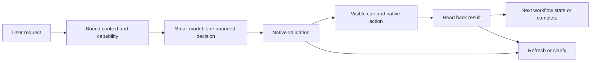

# A strong Hush foundation for small local models

**Decision:** target a 2-4B planner/writer and a separate small vision observer on 16 GB M2-M5 MacBooks. A 9B model is outside the requested product profile. Keep Parakeet and native local voice. Improve task completion through the surrounding software before increasing model size.

This is an implementation strategy backed by source research and [local development tests](benchmarks/quality-followup-2026-10-31.md). It does not claim that these components have already been implemented or that a small model has acquired the general reasoning ability of a larger one.

## Evidence and what transfers

| Primary evidence | Finding | Hush application and limit |
| --- | --- | --- |
| [EffGen, 2026, Table 3](https://arxiv.org/html/2602.00887v1) | Its 1.5B aggregate falls from 47.44 to 36.21 when prompt optimization is removed, an 11.23 percentage-point difference. | Test concise, task-specific context and instructions. This is the authors' multi-benchmark ablation, not Mac GUI performance or a promised Hush gain. We do not need their full Python framework. |
| [Executable Agentic Memory, ICML 2026](https://proceedings.mlr.press/v306/qin26m.html) | Structured reusable action routines and state-aware search improve the authors' Android automation results. | Use small, reviewed Mail/Finder/browser workflows with explicit state. Do not copy Android scores, add MCTS by default, or replay stale coordinates. |
| [Agent S2](https://arxiv.org/abs/2504.00906) | Separating planning and specialist grounding improves its computer-use system over its baselines. | Keep visual perception separate from the action planner. The paper uses a different model/system budget; it does not prove a 2B Mac planner is sufficient. |
| [Apple ToolSandbox](https://machinelearning.apple.com/research/toolsandbox-stateful-conversational-llm-benchmark) | State dependencies and insufficient information remain hard even when a model can emit a function call. | Test real state transitions and final outcomes, not just JSON or function names. |
| [MLX Structured](https://github.com/petrukha-ivan/mlx-swift-structured) | Provides native Swift constrained decoding through XGrammar. | Restrict the next output to a schema with legal actions and observed IDs. It cannot decide which legal action is correct. |
| [Small Language Models Need Strong Verifiers](https://web.eecs.umich.edu/~wangluxy/papers/ACL2024_zhang_etal.pdf) | The studied models improve with strong verification, but weak self-verification limits correction. | Repair from concrete validator errors and fresh observations. Repeatedly asking the same model to reconsider is not an independent correctness check. This study concerns reasoning, not Mac execution. |
| [MLX-LM LoRA/QLoRA](https://github.com/ml-explore/mlx-lm/blob/main/mlx_lm/LORA.md) | Supports task adaptation without full-model retraining. | Consider a small task/language adapter after collecting stable failure categories. Qualify the exact architecture, adapter, quantization, and native runtime before shipping. |

The practical conclusion is to reduce the number and difficulty of decisions the model must make, supply reliable facts, and check outcomes outside the model. Treat every claimed improvement as a hypothesis until it passes a matched Hush evaluation.

## 0. Make the model-runtime contract correct

Before attributing errors to a checkpoint, verify its tokenizer, chat template, stop tokens, image processor, quantized conversion, native tool grammar, and sampling implementation against a reference. Matching a model card's parameter names and numbers is insufficient. The local follow-up documents an MLX presence-penalty behavior that includes prompt tokens and can affect copying tool names/IDs. Test generated-token-only penalties and a no-penalty control before choosing the production policy. Keep original results and report the configuration change separately.

Freeze a validated development configuration before the held-out evaluation. Add small conformance fixtures for tool delimiters, exact names/IDs, Unicode, stopping, and budget exhaustion. Do not silently repair invalid model output into the expected answer. This is part of the foundation, alongside the app workflow.

## 1. Compile app state into a small task context

Create a `ContextSnapshot` from the active app adapter. Include app/window/tab identity, snapshot revision, focused field, selection, relevant text, and observed element IDs with supported operations. Preserve exact user-visible names. Exclude unrelated windows and large DOM subtrees. Keep data separate from instructions; text inside a page or email cannot define capabilities.

The adapter resolves mechanics: a compose body is already identified as a compose body; a Finder folder is a real filesystem URL; a browser target has a stable document/element binding. The model should not infer these from screenshots, titles, or guessed paths.

Use AX/DOM first, Vision OCR for missing text, and the small VLM for unresolved visual information. Capture only the relevant window/crop. A visual answer carries its source snapshot and coordinate convention. If text or identity remains uncertain, expose that uncertainty instead of fabricating an element.

Start with a 4K planner context budget. Preserve the request, current state, selected evidence, constraints, and last verified outcome before optional examples. Drop irrelevant context by structure, not by blindly cutting the end of a prompt or compressing exact filenames into a lossy summary.

## 2. Give the model a small decision, not the entire Mac

First choose a supported capability: draft/rewrite, organize, navigate/fill, explain, or clarify. Use an explicitly selected mode and native context when sufficient. Otherwise make one bounded model classification. A route does not grant execution authority.

Then provide only that capability's next-step tools, normally two to five including abstention. Use distinct, concrete names and short descriptions. Do not expose seven near-overlapping generic functions in every app. The local named-tool diagnostic tests one interface improvement; capability filtering is a further experiment, not a measured result yet.

Where there is one valid destination, bind it in native code and remove the target choice from the model entirely. For example, the email writer returns draft content to a previously verified compose binding. It does not choose between Subject, Body, and Send. A browser navigation step still needs a target decision; its schema enumerates only current eligible element IDs.

The capability registry is generated by reviewed adapters and policy, never by text found on a webpage. If no valid destination exists, the coordinator stops before asking the model to improvise one.

## 3. Constrain generation, then validate semantics

Use typed outputs for route selection, action proposals, and draft blocks. Build a small dynamic schema from the current capability and snapshot. Include an explicit abstain result. Apply token-level grammar constraints rather than relying only on a prompt that asks for JSON. Reject truncated output and unsupported schema constructs.

Hush's pinned MLX Swift LM 3.31.4 has a `LogitProcessor` extension point and a streaming `ToolCallProcessor`. Parsing generated text is distinct from masking invalid next tokens. The third-party [MLX Structured package manifest](https://raw.githubusercontent.com/petrukha-ivan/mlx-swift-structured/main/Package.swift) declares macOS 14+, Swift tools 6.2, MLX from 0.31.5, and MLX Swift LM from 3.31.4. These are promising compatibility bounds for Hush, not a completed integration test. Its `@Generable` convenience needs newer OS support; ordinary JSON Schema does not require switching the app's baseline to macOS 26.

Prototype that native wrapper behind `ConstrainedGenerator`; pin its revision and XGrammar submodule. Test JSON Schema support, Unicode, nullable arguments, enums, EOS, cancellation, token budgets, and per-token overhead on M2. Respect the checkpoint's tool format: Qwen3's JSON-style example is not automatically Qwen3.5's XML-style grammar. Compare native tool grammar against direct constrained typed output on identical cases.

After generation, native validation checks capability, argument types, current IDs, app/document revision, field role, secure-field status, and operation preconditions. Before mutation, re-read the target. A valid JSON object or an ID from an earlier snapshot is insufficient. Missing, ambiguous, or changed targets trigger a new observation or a clear pause.

## 4. Put supported tasks in small state machines

Use explicit workflow states, not a model-generated program:

| Capability | Model responsibility | Native responsibility |
| --- | --- | --- |
| Email | Understand the requested changes; write or revise content | Bind compose body; render paragraphs/lists; preserve signature; insert; verify text and formatting |
| Finder | Interpret a supported organization request; optionally suggest semantic groups | Resolve folder; classify by type/date; detect collisions; preview; move; journal; undo |
| Browser | Choose the next supported semantic step from current evidence | Resolve permitted element; apply action; wait for the resulting state; invalidate old bindings |
| Explain | Produce a concise explanation from supplied evidence | Show the referenced target and preserve uncertainty; never mutate as a side effect |

Reviewed recipes are versioned by app and capability. Store preconditions, transitions, postconditions, and recovery behavior. For a new page, observe again and select a fresh target. Never turn a successful trace into unrestricted automatic replay.

Use one retry for a recoverable failure, with the validator's actual error and a fresh snapshot. Do not repeat a possibly committed mutation. Track operation IDs and verify uncertain outcomes before retrying. The existing PRD's eight-action/60-second ceiling still applies. Escape and user interaction invalidate queued work.

The Hush cursor and activity UI are views of this state machine. They show the true target, upcoming operation, and verified outcome; they do not show model speculation as progress.

## 5. Improve writing with facts and structure

Action scaffolding does not automatically fix German grammar or invented commitments. Keep writing evaluation separate.

Represent the requested draft as a bounded `DraftBrief`: language, tone, recipient as provided, requested facts, forbidden changes, and source spans. Extraction is itself fallible. Check unambiguous amounts, dates, names, URLs, and requested conditions against the source; ask a short question when a material ambiguity cannot be resolved. Do not infer gender, titles, deadlines, or a meeting location from a name.

The writer returns content blocks, not arbitrary HTML. A deterministic renderer handles paragraphs, lists, emphasis, links, escaping, and destination-specific output. For common confirmations, compare reviewed language-specific sentence patterns with free composition. They must preserve the request, not insert standard promises or invented facts.

Run mechanical checks for required facts, changed numbers, language, missing sign-off, and unsupported markup. These checks cannot prove semantic equivalence or grammatical quality. If a specific check fails, allow one targeted repair while preserving already validated facts. For open-ended quality, use blinded human review of held-out English/German examples rather than treating the writer's own critique as ground truth.

Start with a few curated examples per task/language, retrieved by capability and locale. Keep exact evaluation requests and close paraphrases out of those examples. No vector database or extra embedding model is necessary for this small initial library.

If the same errors persist, evaluate a task/language LoRA on licensed, reviewed synthetic or consented data. Include abstention, stale-state, injection, and factual-preservation examples. Split by workflow family, app, layout, and language pattern; random row splits can leak near-duplicates. Distillation from stronger systems is an optional offline data-production step under suitable terms, not a cloud inference fallback. Ship a fixed tested artifact, with no automatic training on users' emails or screens.

## 6. Measure the foundation's contribution

Keep the exact 2-4B weights, quantization, sampler, and test tasks fixed. Evaluate cumulative stages, and remove individual components from the final system to check their contribution:

| Stage | Change | What must improve |
| --- | --- | --- |
| A | Native model template and native tool parser | Establish format, decision, and writing baselines |
| B | Bound AX/DOM context, capability-specific tools, exact-ID enums | Correct supported decisions and valid target rate |
| C | Grammar-constrained generation | Schema validity without degraded semantic accuracy or unacceptable latency |
| D | Native preconditions and state-machine execution | No wrong-field/stale/excluded mutation; preserve supported-task completion |
| E | Read-back verification and one bounded recovery | Verified completion; lower silent-failure rate |
| F | Curated examples and, separately, an optional adapter | Held-out language/task improvement without regressions |

Measure **completed requested tasks**, correct abstentions, false refusals, blocked unsafe proposals, successful recovery, and unverified outcomes separately. A guard that blocks everything is not a successful assistant. A blocked unsafe proposal is an improvement in containment, not evidence that the model chose correctly. Do not count a parser repair or a hand-coded expected answer as model reasoning.

Use the PRD's held-out Mail/Gmail/Finder/browser sets and real app assertions. Keep the original small diagnostic results for regression, but do not tune on them and then advertise them as general accuracy. Record full-stack peak footprint, swap delta, cold/warm latency, and cancellation on a 16 GB M2 Air before declaring the profile ready.

## Implementation order

1. Build the fixture-backed app adapter, snapshot/binding types, typed proposals, validator, and journal. Test with a fake model emitting wrong, duplicated, delayed, and truncated proposals.
2. Complete one vertical Apple Mail journey, including formatted insertion, read-back, interruption, and the visible Hush cursor.
3. Integrate the 2-4B planner and writer behind those contracts. Compare scoped tools and constrained generation against the recorded baseline.
4. Add Finder and then the Chrome/Gmail adapter with their own state transitions and tests.
5. Qualify the separate vision observer and local voice. Add examples/adapters only when measured errors justify them.

This keeps the difficult OS mechanics testable without a model, and makes model changes measurable without rewriting the product. No 9B fallback, cloud fallback, generic shell executor, or collection of simultaneously running planning models is part of the design.
