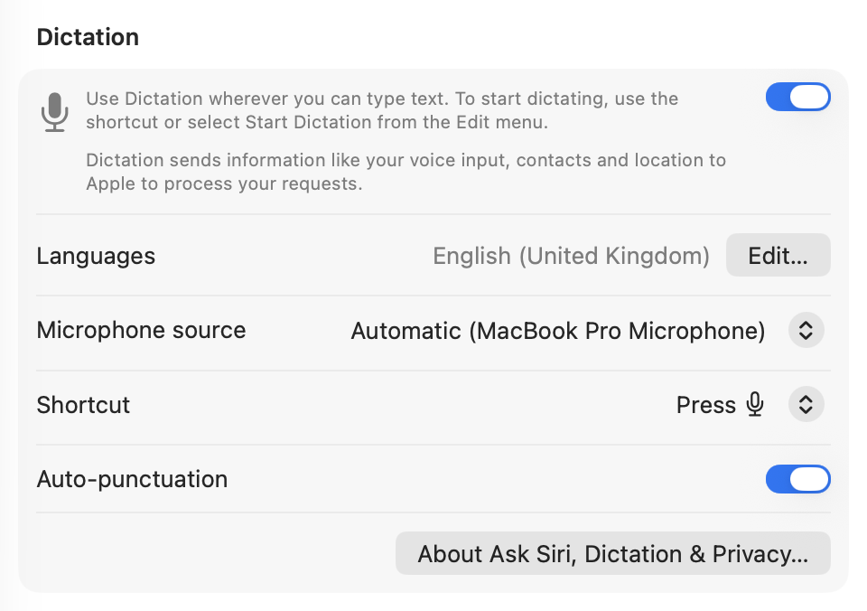
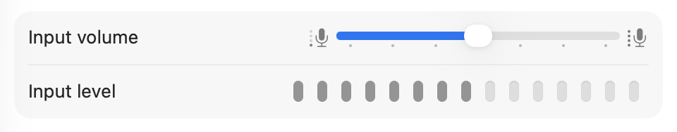
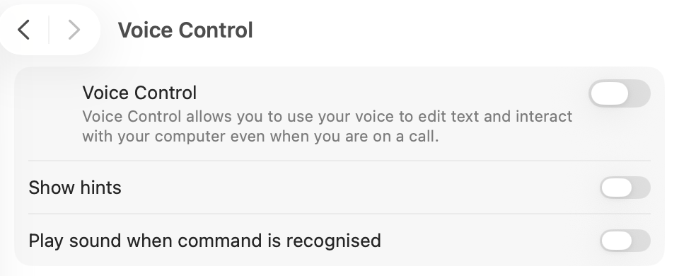

# Dictation not working on your Mac? Start with what you see

When Dictation is not working on your Mac, whether a MacBook Air, a MacBook Pro or a desktop Mac, the cause is usually a setting, the microphone or a stuck speech service, and what you see on screen tells you which. Start with these three quick fixes:

> [!TLDR]
> - **Turn Dictation off and on** in System Settings > Keyboard > Dictation.
> - **Choose the built-in microphone** as the microphone source in the same section.
> - **Restart the speech service:** run `killall corespeechd` in Terminal. No password needed.

This guide is sorted by symptom. Before writing it, we tested the speech service restart and offline dictation on a MacBook Pro with M5 running macOS Tahoe 26.3, on November 12, 2026. Everything else is based on Apple's own documentation, linked where it is used.

## Try these three fixes first

**1. Turn Dictation off and on.** Open System Settings, click Keyboard, scroll to Dictation and switch it off. Wait a few seconds, switch it on again and click Enable if macOS asks. This reloads the Dictation setup without touching anything else.

**2. Check the microphone source.** In the same Dictation section, the "Microphone source" menu shows which device your Mac listens to. [Apple explains](https://support.apple.com/guide/mac-help/use-dictation-mh40584/mac) that Automatic picks the device you are most likely to use. That guess is sometimes AirPods or another Bluetooth headset that is still connected, or a display without a microphone. Pick the built-in microphone to rule this out.



**3. Restart the speech service.** Open Terminal and run:

```
killall corespeechd
```


In our test, this needed no administrator password, and macOS started a fresh `corespeechd` process 0.19 seconds later. Dictation worked on the next try. Some guides recommend `sudo killall -9 corespeechd`. On macOS 26.3 the plain command was enough, because `corespeechd` runs under your own user account. A separate system process, `corespeechd_system`, is not touched by it.

## Find your symptom

| What you see | Most likely cause | Where to look |
|---|---|---|
| Nothing happens when you press the shortcut | Shortcut changed, or the key is assigned to something else | [The shortcut does nothing](#nothing-happens-when-you-press-the-dictation-shortcut) |
| Siri opens instead of Dictation | Microphone key held instead of pressed | [The shortcut does nothing](#nothing-happens-when-you-press-the-dictation-shortcut) |
| Microphone icon appears, but no text | Wrong microphone, low input level, stuck speech service | [Icon but no text](#the-microphone-icon-appears-but-no-text-is-typed) |
| Dictation switch is missing or grayed out | Voice Control is on, or a restriction applies | [Grayed out](#dictation-is-grayed-out-or-missing) |
| Dictation stops by itself | 30 seconds without speech | [Stops by itself](#dictation-stops-after-a-pause) |
| Wrong words or wrong language | Dictation language, noise | [Wrong words](#wrong-words-or-the-wrong-language) |

## Nothing happens when you press the Dictation shortcut

Start with the shortcut itself. In Keyboard settings, the Dictation section has a Shortcut menu, and it may not be the key you remember. Apple notes that choosing a shortcut can also change the "Press fn key to" option, so a key that used to start Dictation may now do something else.

On our test Mac, the shortcut was the Microphone key, while the Globe key was set to "Show Emoji & Symbols" in the same Keyboard settings. Pressing Globe there opens the emoji picker, not Dictation. If you are used to the Globe key, check both settings.

If your keyboard has a Microphone key, the difference between pressing and holding matters. According to [Apple](https://support.apple.com/guide/mac-help/use-dictation-mh40584/mac), pressing and releasing it starts Dictation, while pressing and holding it activates Siri. If Siri keeps showing up, tap the key instead.

Keyboard remapping tools, such as Karabiner-Elements, can also intercept the key before macOS sees it. A quick test that skips the shortcut entirely: open TextEdit and choose Edit > Start Dictation from the menu bar. If that works, Dictation is fine and the problem is the key.

## The microphone icon appears, but no text is typed

The icon means Dictation started, so the problem is in what it hears or in the speech service.

Check the microphone source first, as described above. Then open System Settings > Sound > Input, speak and watch the input level. If the meter barely moves, raise the input volume or move closer. [Apple also suggests](https://support.apple.com/guide/mac-help/if-dictation-on-mac-doesnt-work-as-expected-mchlc480652b/mac) checking that nothing covers the built-in microphone and avoiding rooms with a lot of echo or background noise.



If the level is fine and still no text appears, restart the speech service with `killall corespeechd`. When we watched the processes on our test Mac, two more appeared only while Dictation was active, `localspeechrecognition` and `com.apple.siri.embeddedspeech`. They start on demand, so a missing process in Activity Monitor is not a problem by itself when Dictation is off.

## Dictation is grayed out or missing

The most common reason is Voice Control. [Apple states](https://support.apple.com/guide/mac-help/use-dictation-mh40584/mac) that when Voice Control is on, you dictate through Voice Control and standard macOS Dictation is not available. Check System Settings > Accessibility > Voice Control and turn it off if you want the regular Dictation.



Two more things are worth checking:

- **Screen Time.** Under Screen Time > Content & Privacy, Siri and related features can be restricted. If someone set up Screen Time on your Mac, look there.
- **A managed Mac.** On a Mac from work or school, an administrator can restrict features through device management. If the switch is locked, the IT team is the right contact.

Dictation is also not offered in every language or region. Apple lists the supported languages on its [macOS feature availability page](https://www.apple.com/macos/feature-availability/#dictation).

## Dictation stops after a pause

This one is by design. [Apple documents](https://support.apple.com/guide/mac-help/use-dictation-mh40584/mac) that you can dictate text of any length without a timeout, but Dictation stops automatically when no speech is detected for 30 seconds. If you pause to think, start it again with the shortcut.

On a Mac with Apple silicon, you can also type while Dictation is running. Apple says the cursor stops pulsing while you type and resumes when you stop, so you do not need to end Dictation to fix a word.

## Wrong words or the wrong language

Open the Dictation section in Keyboard settings and click Edit next to Languages. Make sure the language you speak is selected. If you set up more than one, you can switch while dictating by clicking the language shown next to the cursor.

For single words, Apple underlines ambiguous results in blue. Click the underlined word to pick an alternative. Numbers and times are formatted for you: in our test, "seven fifteen" became "7:15" and "platform four" became "platform 4".

## Does Mac Dictation need the internet?

It depends on the language and the text field. [Apple says](https://support.apple.com/guide/mac-help/use-dictation-mh40584/mac) the text below the Dictation switch in Keyboard settings tells you whether your voice input is processed on your Mac. Search boxes are an exception and can still use Apple's servers.

That text is worth reading closely. On our test Mac it said: "Dictation sends information like your voice input, contacts and location to Apple to process your requests." So we checked what happens without a connection.

We tested it. On our MacBook Pro with M5 and macOS 26.3, English (US and UK) and German were installed for on-device use. We turned Wi-Fi off, confirmed that apple.com could not be reached, and dictated a sentence into TextEdit. It came out as "The train to Hamburg leaves at 7:15 from platform 4." That shows on-device Dictation working in TextEdit without a connection. We did not test search fields or other apps offline.

## When a separate dictation app makes sense

If Apple Dictation works for you after these fixes, there is no need to install anything else. A separate app is worth a look when you want to choose the speech model yourself, need languages Apple does not offer on-device, or want to see in the source code what happens to your voice. [hush](/) is one such app. It is free and open source during the alpha, and once the models are downloaded, transcription runs on your Mac. Model downloads and updates need an internet connection. hush is not affiliated with Apple.

## Frequently asked questions

### Why has my dictation stopped working on my Mac?

Most often the microphone source changed, the shortcut changed, or the speech service is stuck. Turn Dictation off and on in Keyboard settings, select the built-in microphone, and run `killall corespeechd` in Terminal.

### How do I reset the microphone on my Mac?

There is no single reset button. Select the microphone again under System Settings > Sound > Input and as the microphone source in the Dictation settings. Then check that the input level moves when you speak.

### Why does voice typing not work in Chrome or Google Docs?

Start Dictation in TextEdit first. If it works there, macOS Dictation is fine, and the issue is with the website or browser. Google Docs also has its own [voice typing feature](https://support.google.com/docs/answer/4492226), which is separate from Apple Dictation.

### Does Mac Dictation work offline?

For languages that are installed on your Mac, it can. In our test on macOS 26.3, Dictation in TextEdit worked with Wi-Fi turned off, even though the Keyboard settings said Dictation sends voice input to Apple. Search boxes and other apps may behave differently.

## Sources and how we tested

- Apple Support, [Dictate messages and documents on Mac](https://support.apple.com/guide/mac-help/use-dictation-mh40584/mac). Accessed November 12, 2026.
- Apple Support, [If Dictation on Mac doesn't work as expected](https://support.apple.com/guide/mac-help/if-dictation-on-mac-doesnt-work-as-expected-mchlc480652b/mac). Accessed November 12, 2026.
- Apple Support, [Block features or content with Screen Time on Mac](https://support.apple.com/guide/mac-help/block-features-or-content-with-screen-time-mchl8490d51e/mac). Accessed November 12, 2026.
- Apple, [macOS feature availability: Dictation](https://www.apple.com/macos/feature-availability/#dictation). Accessed November 12, 2026.
- Google Docs Help, [Type with your voice](https://support.google.com/docs/answer/4492226). Accessed November 12, 2026.

**How this guide was prepared:** We tested the speech service restart, offline dictation and the dictation settings on a MacBook Pro with M5 and 16 GB of memory, running macOS 26.3, on November 12, 2026. The screenshots come from that Mac, cropped to the relevant settings. Fixes we did not test ourselves, such as Screen Time and Voice Control, are based on Apple's documentation above and say so in the text. AI tools assisted with research and drafting; the author checked every claim and step before publishing. hush is our own product, and it is mentioned once, after the fixes.

Apple, Mac, macOS and Siri are trademarks of Apple Inc.
